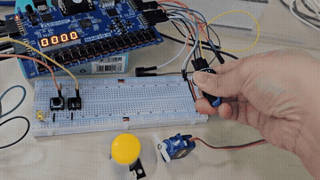
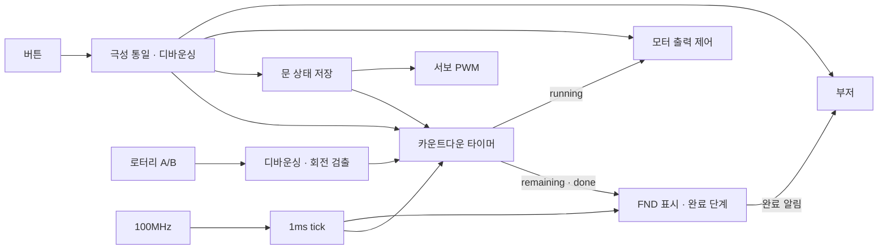
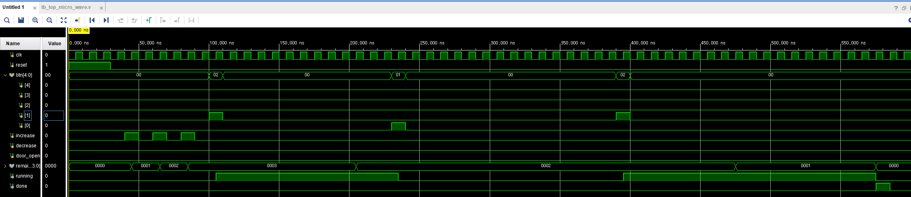

# FPGA Microwave Controller

Basys 3와 Verilog HDL로 구현한 전자레인지 제어 시스템입니다. 로터리로 시간을 설정하고, 시작·일시정지·취소와 문 개폐에 맞춰 타이머, 모터, 서보, FND, 부저를 제어합니다. 실제 가열 기능 없이 주변장치로 전자레인지의 동작을 구현했습니다.

## 동작 영상

[](media/demo.mp4?raw=true)

[소리 포함 동작 영상](media/demo.mp4?raw=true) · [발표자료](docs/fpga-microwave-controller.pptx)

GIF는 무음 미리보기입니다. 버튼 효과음과 완료음은 MP4에서 확인할 수 있습니다. 발표자료는 GitHub 파일 페이지의 **Download raw file**로 내려받을 수 있습니다.

## 주요 기능

- **시간 설정:** 로터리 한 단계마다 1초 증감, 0~9999초 범위, 정지 중에 설정 가능
- **카운트다운:** 1초마다 감소, 일시정지 시 남은 시간과 1초 미만의 진행량 유지
- **문 제어:** 열기·닫기 상태를 저장하고 서보 위치 유지, 문이 열린 상태에서 시작 차단
- **모터 제어:** 조리 중 한 방향 구동, 일시정지·취소·문 열기·종료 시 출력 차단
- **FND:** 남은 시간을 4자리 십진수 초 단위로 표시
- **완료 알림:** 자연 종료 시 FND 깜빡임과 2kHz 부저를 3회 동기화
- **버튼 피드백:** 시작·문 열기 4음 멜로디, 일시정지·취소·문 닫기 단음

## 개발 환경

| 항목 | 구성 |
| --- | --- |
| FPGA 보드 | Digilent Basys 3 |
| 디바이스 | Artix-7 `xc7a35tcpg236-1` |
| 개발 도구 | Vivado 2020.2 |
| 언어 | Verilog HDL |
| 시스템 클럭 | 100MHz, 10ns |
| 주변장치 | 로터리 엔코더, 외부 문 버튼, DC 모터·드라이버, 서보, 부저 |
| 합성 Top | `top_micro_wave` |
| 시뮬레이션 Top | `tb_top_micro_wave` |

## 시스템 구조



타이머의 `running`, `remaining`과 Top의 `r_door_open`으로 동작 상태를 표현합니다. 문 상태는 타이머와 서보가 공유하고, 완료 알림 단계는 FND와 부저가 공유합니다.

## 조작 방법

| 입력 | 동작 | FPGA 핀 / 연결 |
| --- | --- | --- |
| 로터리 `s1`, `s2` | 시계방향 +1초, 반시계방향 −1초 | M18 / N17, JC2 / JC3 |
| `btn[0]` | 일시정지 | W19, BTNL |
| `btn[1]` | 시작·재개 | U18, BTNC |
| `btn[2]` | 취소, 시간 초기화 | T17, BTNR |
| `btn[3]` | 문 열기, 조리 정지 | J3, 외부 버튼, Active Low |
| `btn[4]` | 문 닫기 | L3, 외부 버튼, Active Low |
| `reset` | 전체 초기화 | R2, SW15, Active High |

1. 리셋을 해제한 뒤 로터리로 조리 시간을 설정합니다.
2. 문을 닫고 시작 버튼을 누르면 카운트다운과 모터가 동작합니다.
3. 일시정지 또는 문 열기 버튼을 누르면 남은 시간을 유지하며 정지합니다.
4. 문을 닫은 뒤 시작 버튼을 눌러 재개합니다. 문 닫기만으로 자동 재개하지 않습니다.
5. 0초에 도달하면 모터가 정지하고 FND와 부저로 완료를 알립니다.
6. 취소 버튼은 시간을 0으로 초기화하며 완료 알림을 발생시키지 않습니다.

타이머 입력 우선순위는 **취소 → 문 열기·일시정지 → 정지 중 시간 설정 → 시작 → 카운트다운**입니다. 문이 열려 있어도 시간을 설정할 수 있고, 0초에서는 시작하지 않습니다.

## 설계 포인트

### 입력 안정화와 회전 방향 검출

내부 버튼은 Active High, 외부 문 버튼은 Active Low이므로 `w_pressed_btn = {~btn[4:3], btn[2:0]}`으로 누름 조건을 통일했습니다. 2단 플립플롭 동기화 후 버튼은 약 10ms, 로터리는 약 2ms 동안 입력을 안정화합니다.

로터리는 다음 정상 전이를 누적해 4회 전이마다 증감 펄스를 한 번 출력합니다. 두 비트가 동시에 바뀌는 잘못된 전이는 누적값을 초기화합니다.

- 시계방향: `00 → 10 → 11 → 01 → 00`
- 반시계방향: `00 → 01 → 11 → 10 → 00`

### 시간과 완료 이벤트 분리

100MHz에서 1ms tick을 생성하고, 타이머가 tick 1000회를 세어 1초를 만듭니다. 자연 종료의 마지막 1초에서 `remaining=0`, `running=0`으로 전환하고 `done`을 한 클럭 동안 출력합니다. 리셋과 취소는 완료 이벤트를 만들지 않습니다.

### 문 위치 유지와 모터 제어

문 상태를 `r_door_open`에 저장해 버튼을 놓아도 서보의 목표 위치가 유지됩니다. 서보는 20ms 프레임에서 닫힘 1ms, 열림 2ms 펄스를 출력하며 프레임 경계에서 펄스 폭을 갱신합니다.

모터 제어의 기본 설정은 `PWM_HZ=1_000`, `DUTY_PERCENT=100`입니다. 현재 설정에서 조리 중 ENA는 계속 HIGH이며, IN1=1·IN2=0으로 한 방향 구동합니다. 정지하면 ENA·IN1·IN2를 모두 0으로 내립니다. Top은 PWM 파라미터를 덮어쓰지 않아 설정을 `pwm_duty_control`에서 관리합니다.

### 표시와 소리의 동기화

FND는 1ms마다 표시 자리를 바꾸며 남은 초를 표시합니다. 조리 완료 시 0.5초 단계를 6번 진행해 총 3초 동안 알립니다.

| 단계 | 시간 | FND | 부저 |
| --- | --- | --- | --- |
| 0, 2, 4 | 각 0.5초 | 소등 | 2kHz |
| 1, 3, 5 | 각 0.5초 | `0000` 표시 | 무음 |

시작과 문 열기는 한 음당 70ms의 4음 멜로디를 재생합니다. 일시정지·취소·문 닫기와 리셋 해제는 2kHz 단음을 70ms 재생합니다. 버튼의 상승 에지를 검출해 길게 눌러도 반복 재생하지 않으며, 완료음이 버튼음보다 우선합니다.

## 핀 연결

| 출력 | 연결 | FPGA 핀 |
| --- | --- | --- |
| `pwm_out` | 모터 드라이버 ENA, JA1 | J1 |
| `in1_in2[0]`, `[1]` | 모터 드라이버 IN1·IN2, JA2·JA3 | L2 / J2 |
| `servo` | 서보 신호, JB1 | A14 |
| `buzzer` | 부저 신호, JC1 | K17 |
| `pwm_out_led` | PWM 상태, LD0 | U16 |
| `seg[7:0]`, `an[3:0]` | 보드 내장 4자리 FND | XDC 참조 |

핀 배치와 100MHz 클럭 제약은 [XDC](constrs_1/Basys3-Master_orginal.xdc)에 정의되어 있으며 외부 I/O 표준은 LVCMOS33입니다.

## 시뮬레이션



[tb_top_micro_wave.v](sim_1/tb_top_micro_wave.v)는 `microwave_timer`를 대상으로 다음 시나리오를 실행합니다. `SECOND_TICKS=10`, `tick=1`로 설정해 10클럭을 1초로 취급합니다.

| 순서 | 입력 / 동작 | 파형 |
| --- | --- | --- |
| 1 | 리셋 후 증가 펄스 3회 | `remaining`: 0 → 1 → 2 → 3 |
| 2 | `btn[1]` 시작 | `running=1`, 3 → 2 |
| 3 | `btn[0]` 일시정지 | `running=0`, 남은 시간 2 유지 |
| 4 | `btn[1]` 재개 | `running=1`, 2 → 1 → 0 |
| 5 | 자연 종료 | `running=0`, `done` 1클럭 펄스 |

## Vivado 실행 방법

1. RTL Project를 만들고 디바이스를 `xc7a35tcpg236-1`로 선택합니다.
2. `sources_1`의 Verilog 9개를 Design Sources에 추가합니다.
3. `constrs_1/Basys3-Master_orginal.xdc`를 Constraints에 추가합니다.
4. 합성 Top을 `top_micro_wave`로 설정합니다.
5. 시뮬레이션은 `sim_1/tb_top_micro_wave.v`를 Simulation Sources에 추가하고 Top을 `tb_top_micro_wave`로 지정한 뒤 **Run Behavioral Simulation → Run All**을 실행합니다.
6. 보드 실행은 **Run Synthesis → Run Implementation → Generate Bitstream** 순서로 진행하고 Hardware Manager에서 프로그램합니다.

## 파일 구성

```text
FPGA-Microwave-Controller/
├── sources_1/     # RTL
├── sim_1/         # 타이머 테스트벤치
├── constrs_1/     # Basys 3 핀·클럭 제약
├── docs/         # 발표자료
├── media/        # 동작 영상, GIF, 시뮬레이션 파형
└── README.md
```

| RTL 파일 | 역할 |
| --- | --- |
| [top_micro_wave.v](sources_1/top_micro_wave.v) | 모듈 연결, 버튼 극성 처리, 문 상태 저장, 모터 동작 조건 |
| [microwave_timer.v](sources_1/microwave_timer.v) | 시간 설정, 시작·정지·취소, 카운트다운, 완료 펄스 |
| [btn_debounce10ms.v](sources_1/btn_debounce10ms.v) | 2단 동기화와 입력 디바운싱 |
| [rotary.v](sources_1/rotary.v) | 로터리 전이 누적과 방향 판별 |
| [tick_generator.v](sources_1/tick_generator.v) | 1ms tick 생성 |
| [fnd_controller.v](sources_1/fnd_controller.v) | BCD 변환, FND 다중화, 완료 알림 단계 |
| [pwm_duty_control.v](sources_1/pwm_duty_control.v) | 모터 PWM과 방향 출력 |
| [servo_controller.v](sources_1/servo_controller.v) | 문 개폐 서보 펄스 생성 |
| [play_poweron_opendoor.v](sources_1/play_poweron_opendoor.v) | 버튼 효과음과 완료음 |

## 구현 중 해결한 문제

| 문제 | 해결 |
| --- | --- |
| 외부 문 버튼과 내부 버튼의 입력 극성 차이 | Top에서 외부 버튼을 반전해 누름 조건 통일 |
| 문 버튼을 놓으면 서보 목표가 바뀌는 문제 | 문 상태를 레지스터에 저장하고 다음 명령까지 유지 |
| Top과 PWM 모듈의 듀티 설정 불일치 | Top의 덮어쓰기를 제거하고 PWM 모듈에서 설정 관리 |
| 완료 표시와 소리의 타이밍 연동 | FND와 부저가 동일한 완료 단계 신호를 사용 |
| 취소와 자연 종료를 구분할 필요 | 자연 종료에만 `done` 펄스를 생성 |
